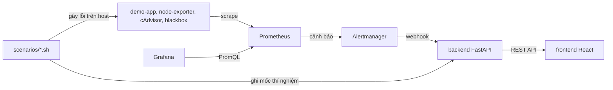

# N4.7 – Hệ thống giám sát máy chủ, Cloud và trung tâm dữ liệu (prototype)

Prototype giám sát chạy trong môi trường lab kiểm soát: thu thập metric CPU, RAM, disk, network, uptime và tình trạng endpoint; hiển thị trên dashboard; phát cảnh báo khi vượt ngưỡng; mô phỏng lỗi và đo thời gian phát hiện (MTTD).

Đề tài thuộc nhóm N4 – Mạng, IoT và hạ tầng số, thời gian thực hiện 18 tuần (01/11/2026 – 06/03/2027). Đây là bản minh họa vận hành theo hướng cloud-native, **không thay thế NOC/DCIM chính thức**.

## Hệ thống gồm những gì

| Thành phần | Vai trò |
| --- | --- |
| Prometheus | Thu thập metric (scrape 15 giây), chấm luật cảnh báo |
| Node Exporter | Metric của host: CPU, RAM, disk, network, uptime |
| cAdvisor | Metric theo từng container |
| Blackbox Exporter | Thăm dò endpoint (`probe_success`, thời gian phản hồi) |
| Alertmanager | Gom nhóm cảnh báo, gửi webhook về backend |
| Grafana | Dashboard theo host/service, nạp tự động từ file trong Git |
| backend (Python, FastAPI) | Nhận webhook, ghi thí nghiệm, tính MTTD |
| frontend (TypeScript, React) | Console 4 màn hình: thí nghiệm, lịch sử cảnh báo, kết quả MTTD, trạng thái target |
| demo-app | Dịch vụ mô phỏng làm mục tiêu cho kịch bản lỗi |



## Cấu trúc thư mục

```text
infra/        Cấu hình Prometheus, Alertmanager, Blackbox, Grafana (dashboard + provisioning)
backend/      API FastAPI, nhận webhook, tính MTTD
frontend/     Console React + TypeScript
demo-app/     Dịch vụ mô phỏng (/health, /work, /metrics)
scenarios/    Kịch bản lỗi S1 đến S4 và thư mục results/
scripts/      Script hỗ trợ (đĩa loop cho kịch bản disk đầy)
data/         Hướng dẫn tải dữ liệu NAB, Google Cluster Data, Loghub (không commit dữ liệu)
docs/         Kiến trúc, hướng dẫn dựng lại, runbook, báo cáo kiểm thử, quyết định thiết kế
```

## Yêu cầu

- Ubuntu 22.04 hoặc 24.04 (VM hoặc máy thật), tối thiểu 4 vCPU, 8 GB RAM, 30 GB disk.
- Docker Engine và Docker Compose plugin, Git, `make`, `curl`, `jq`, `stress-ng`, `chrony`.
- Docker Desktop trên Windows/macOS chạy Linux VM ẩn nên Node Exporter chỉ đo máy ảo đó, không phải máy thật. Khi demo hãy dùng Ubuntu thật.

## Dựng lab trong 5 bước

### Bước 1. Chuẩn bị máy và tải mã nguồn

```bash
sudo apt update && sudo apt install -y git make curl jq stress-ng chrony
docker --version && docker compose version    # cài Docker theo hướng dẫn chính thức nếu chưa có

git clone <địa-chỉ-repo> n47-monitoring
cd n47-monitoring
```

### Bước 2. Cấu hình môi trường

```bash
cp .env.example .env
```

Mở `.env`, đổi `GRAFANA_ADMIN_PASSWORD`. Các biến `*_VERSION` ghim phiên bản image; không dùng `latest`. Nếu một tag không kéo về được, chọn bản ổn định gần nhất trên Docker Hub rồi ghi lại trong `.env`. Không commit file `.env` và không dùng credential sản xuất.

### Bước 3. Tạo đĩa loop cho kịch bản disk đầy

```bash
bash scripts/make-loop-disk.sh      # tạo và mount đĩa 1 GB tại /mnt/labdisk
df -h /mnt/labdisk
```

Làm bước này trước khi khởi động lab để Node Exporter thấy phân vùng. Mount không giữ sau khi khởi động lại máy; khi đó chạy `sudo mount -o loop /var/lib/labdisk.img /mnt/labdisk` rồi `docker compose restart node-exporter`.

### Bước 4. Kiểm tra cấu hình và khởi động

```bash
make lint-infra     # promtool check config, promtool test rules, amtool check-config
make up             # docker compose up -d --build
docker compose ps
```

`make lint-infra` phải báo SUCCESS cho cả ba lệnh trước khi khởi động.

### Bước 5. Kiểm tra lab và chạy thử một kịch bản

Mở các địa chỉ sau (các cổng chỉ bind `127.0.0.1`; xem từ máy khác thì dùng SSH tunnel):

| Dịch vụ | Địa chỉ | Kiểm tra |
| --- | --- | --- |
| Prometheus | http://localhost:9090/targets | Mọi target ở trạng thái UP |
| Grafana | http://localhost:3000 | Đăng nhập `admin` và mật khẩu trong `.env`; thư mục N4.7 có 3 dashboard |
| Alertmanager | http://localhost:9093 | Mở được, chưa có cảnh báo đang bật |
| Backend | http://localhost:8000/docs | Hiển thị API |
| Console | http://localhost:8080 | Mở được 4 màn hình |

Chạy thử kịch bản service down (khoảng 2 phút):

```bash
bash scenarios/03_service_down.sh
```

Kết quả đúng: cảnh báo `ServiceDown` hiện ở Alertmanager trong khoảng một phút, xuất hiện ở `GET /api/alerts`, rồi chuyển resolved khi demo-app chạy lại. Xem thời gian phát hiện tại `GET /api/experiments`.

## Kịch bản lỗi

| ID | Kịch bản | Lệnh | Cảnh báo kỳ vọng |
| --- | --- | --- | --- |
| S1 | CPU cao | `bash scenarios/01_cpu_high.sh` | HostHighCpu |
| S2 | Disk đầy giả lập | `bash scenarios/02_disk_full.sh` | HostDiskAlmostFull |
| S3 | Service down | `bash scenarios/03_service_down.sh` | ServiceDown |
| S4 | Spike ngắn (cảnh báo giả) | `bash scenarios/04_short_spike.sh` | Không có cảnh báo nào |

Chạy mỗi kịch bản từ thư mục gốc của repo. Trước khi đo MTTD, kiểm tra đồng hồ đồng bộ bằng `chronyc tracking`. Lưu kết quả vào `scenarios/results/`. Ngưỡng cảnh báo trong `infra/prometheus/rules/` là giá trị khởi đầu, hiệu chỉnh sau khi đo baseline.

## Dừng và dọn lab

```bash
make down                       # dừng các container, giữ dữ liệu
docker compose down -v          # dừng và xóa cả dữ liệu Prometheus, Grafana, backend
```

## Xử lý lỗi thường gặp

- **Target `node` DOWN:** kiểm tra `curl localhost:9100/metrics` trên host, tường lửa, và mục `extra_hosts` của dịch vụ prometheus.
- **Không thấy `/mnt/labdisk` trong metric disk:** đĩa loop chưa được mount, hoặc mount sau khi Node Exporter chạy; chạy `docker compose restart node-exporter`.
- **cAdvisor không có nhãn `name`:** thiếu `privileged` hoặc mount `/var/lib/docker`.
- **Backend không nhận cảnh báo:** xem `docker compose logs alertmanager backend` và kiểm tra URL webhook.

## Phạm vi và an toàn

- Chỉ chạy trên lab do nhóm quản lý. Không kết nối nền tảng quản trị trung tâm dữ liệu thật khi chưa có phân quyền và phê duyệt an toàn thông tin.
- Node Exporter và cAdvisor chạy với quyền cao (mount `/`, `privileged`). Không dùng cấu hình này cho môi trường thật. Cổng 9100 của Node Exporter mở trên mọi interface, hãy chặn từ bên ngoài bằng `ufw`.
- Grafana bật truy cập ẩn danh (chỉ xem) để nhúng panel; chỉ dùng trong lab.
- Không đưa IP, tên hệ thống, log truy cập hoặc sơ đồ trung tâm dữ liệu thật vào repo. Dữ liệu VNPT chỉ dùng khi đã được phê duyệt và đã tổng hợp.

## Tài liệu thêm

- `docs/architecture.md`: sơ đồ kiến trúc
- `docs/setup-guide.md`: hướng dẫn dựng lại lab chi tiết
- `docs/runbooks/`: runbook xử lý từng cảnh báo
- `docs/test-report.md`: kết quả kiểm thử và MTTD
